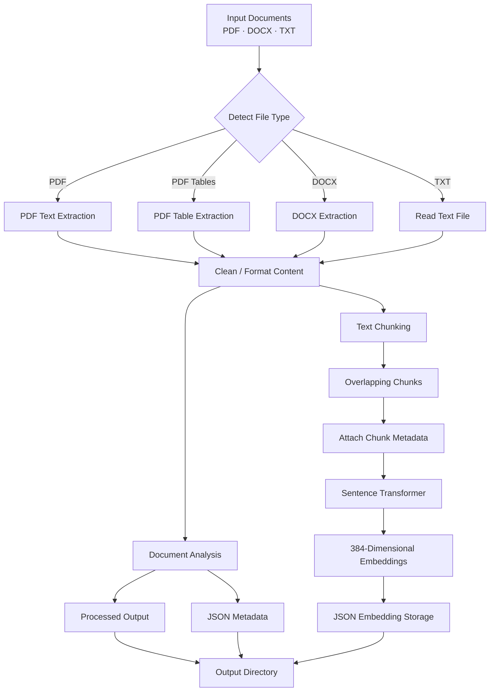

# DocuMind — AI-Powered Document Processing & Semantic Retrieval


**DocuMind** is a Python-based document processing project that extracts, cleans, analyzes, and structures content from PDF, DOCX, and TXT documents. It uses intelligent text chunking and transformer-based embeddings to prepare document content for semantic search and retrieval-augmented generation (RAG).

The goal is to build a modular knowledge intelligence system that transforms unstructured documents into searchable, structured knowledge.

## Key Features

### Document Processing
- **Multi-format support:** Extract content from PDF, DOCX, and TXT files.
- **PDF text extraction:** Extract embedded text using `pypdf`.
- **PDF table extraction:** Extract basic tables while preserving table structure and page information using `pdfplumber`.
- **Structured DOCX processing:** Extract headings, paragraphs, lists, and tables and format supported elements as Markdown.
- **Text cleaning:** Normalize whitespace and prepare extracted content for downstream processing.
- **Document analysis:** Calculate character, word, and line statistics.

### Text Chunking
- **Character-based chunking:** Split large documents into smaller, manageable text segments.
- **Overlapping chunks:** Preserve contextual continuity between consecutive chunks.
- **Metadata-aware chunking:** Associate each chunk with its source filename and chunk index.

### Embedding Generation
- **Transformer-based embeddings:** Generate dense vector representations using Sentence Transformers.
- **Pretrained model:** Uses `all-MiniLM-L6-v2`.
- **Batch encoding:** Generate embeddings for multiple document chunks.
- **Metadata preservation:** Maintain the original chunk text and metadata alongside its embedding.
- **JSON serialization:** Store generated embeddings in a JSON-compatible format.

### Engineering & Reliability
- Modular Python architecture.
- CLI-based document processing using `argparse`.
- Logging and exception handling.
- Automated testing using `pytest`.
- GitHub Actions CI workflow.

## Architecture

The current processing pipeline:



## Tech Stack

| Category | Technologies |
|---|---|
| Language | Python |
| Document Processing | pypdf, pdfplumber, python-docx |
| Text Processing | Python, pathlib |
| Embeddings | Sentence Transformers |
| Embedding Model | all-MiniLM-L6-v2 |
| Numerical Computing | NumPy |
| Testing | pytest |
| CI/CD | GitHub Actions |
| Data Serialization | JSON |

## Project Structure

```text
DocuMind/
│
├── documents/                   # Sample input documents
│
├── processor/
│   ├── analyser.py              # Document statistics
│   ├── cleaner.py               # Text cleaning
│   ├── chunker.py               # Text chunking and metadata
│   ├── embeddings.py            # Embedding generation
│   ├── docx_reader.py           # DOCX extraction
│   ├── formatter.py             # Structured elements to Markdown
│   ├── pdf_reader.py            # PDF text extraction
│   └── pdf_table_reader.py      # PDF table extraction
│
├── tests/
│   ├── test_analyser.py
│   ├── test_chunker.py
│   ├── test_cleaner.py
│   ├── test_docx_reader.py
│   ├── test_embeddings.py
│   ├── test_formatter.py
│   ├── test_pdf_reader.py
│   ├── test_pdf_table_reader.py
│   └── test_pipeline.py
│
├── output/                      # Generated files (gitignored)
├── main.py                      # CLI entry point
├── requirements.txt             # Project dependencies
└── README.md
```

## Installation

### 1. Clone the repository

```bash
git clone https://github.com/RebyTK/DocuMind.git
cd DocuMind
```

### 2. Create a virtual environment

**Windows PowerShell:**

```powershell
py -m venv .venv
.venv\Scripts\Activate.ps1
```

### 3. Install dependencies

```powershell
py -m pip install -r requirements.txt
```

The first embedding-model initialization downloads the pretrained model if it is not already available locally.

## Usage

Place your input documents inside the `documents/` directory.

### Process a TXT document

```powershell
py main.py documents/sample.txt
```

### Process a PDF document

```powershell
py main.py documents/sample.pdf
```

### Process a DOCX document

```powershell
py main.py documents/sample.docx
```

DocuMind processes the document through its extraction, cleaning, analysis, chunking, and embedding pipeline.

## Generated Outputs

Depending on the input document, DocuMind generates:

| Output | Description |
|---|---|
| `sample_cleaned.txt` | Cleaned TXT/PDF content |
| `sample_cleaned.md` | Formatted DOCX content |
| `sample_metadata.json` | Document statistics and metadata |
| `sample_chunks.json` | Text chunks with source metadata |
| `sample_embeddings.json` | Text chunks, metadata, and numerical embeddings |
| `documind.log` | Application execution logs |

Generated files are stored in the `output/` directory.

## Running Tests

Run the complete test suite from the project root:

```powershell
py -m pytest -v
```

**Current test status: 31 tests passing.**

The test suite covers:
- Text cleaning and validation.
- Document statistics.
- Text chunking and overlap.
- Chunk metadata preservation.
- PDF and DOCX extraction.
- PDF table extraction.
- Markdown formatting.
- Embedding generation.
- End-to-end document processing.

## Current Limitations

- Scanned PDFs requiring OCR are not supported.
- Embedded images are not interpreted.
- PDF table extraction may not preserve complex layouts perfectly.
- Chunking currently uses character-based boundaries rather than semantic or structure-aware boundaries.
- Embeddings are currently stored in JSON files rather than a dedicated vector index.
- Semantic search and LLM-based question answering have not yet been implemented.
- The project currently runs as a local CLI application.

## Roadmap

The following capabilities are planned:

- [ ] FAISS vector indexing and storage.
- [ ] Semantic search and top-k document retrieval.
- [ ] Retrieval-augmented generation (RAG).
- [ ] LLM-powered document question answering.
- [ ] Source attribution and citations in generated answers.
- [ ] Hybrid retrieval using keyword and semantic search.
- [ ] Retrieval evaluation and performance metrics.
- [ ] FastAPI backend and Streamlit interface.
- [ ] Docker-based deployment.

## Project Goal

DocuMind is being developed as a practical AI Engineering project to explore document processing, vector embeddings, information retrieval, and RAG system architecture.

The long-term objective is to build a knowledge intelligence platform that can retrieve relevant information from documents and generate grounded, context-aware answers.

---

**Built with Python, Sentence Transformers, and a focus on practical AI Engineering.**
