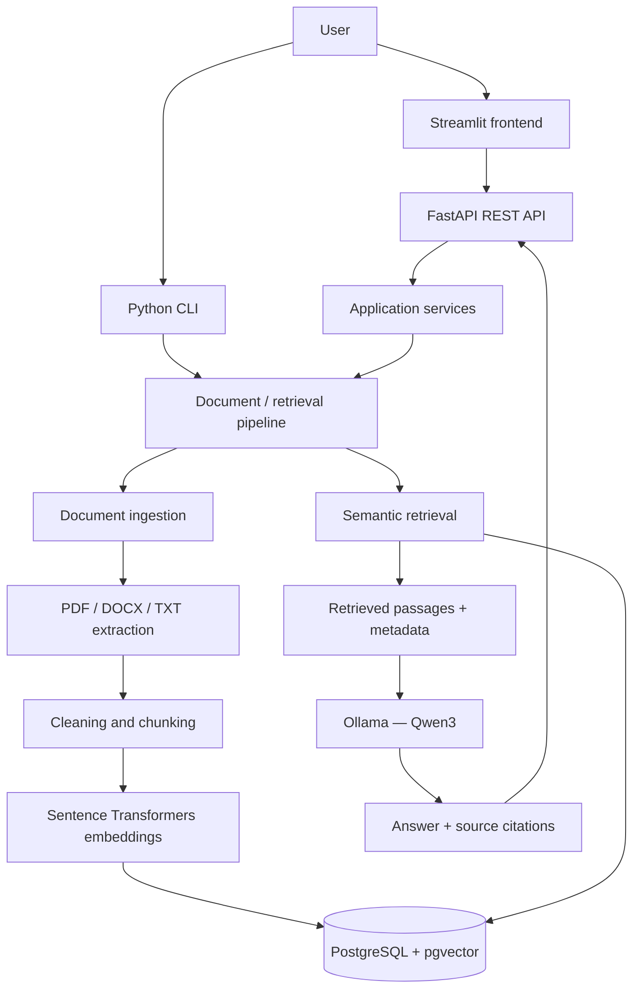

# DocuMind — Local RAG Document Assistant


DocuMind is a local Retrieval-Augmented Generation (RAG) application for uploading documents, searching their contents, and asking questions with source references. It supports PDF, DOCX, and TXT files and combines a Streamlit interface, FastAPI backend, PostgreSQL with pgvector, Sentence Transformers embeddings, and a locally hosted Qwen3 model through Ollama.

**Project focus:** a practical, explainable RAG application. DocuMind uses conventional retrieval and generation rather than agents, fine-tuning, or a hosted LLM API.

## Features

- **Multi-format ingestion:** upload PDF, DOCX, and TXT documents.
- **Text and table extraction:** extract text and supported tables from PDFs, paragraphs and tables from DOCX files, and plain text from TXT files.
- **Chunking and metadata:** split extracted content into overlapping chunks and retain document, chunk, and page metadata where available.
- **Semantic embeddings:** generate 384-dimensional vectors with `sentence-transformers/all-MiniLM-L6-v2`.
- **Persistent vector storage:** store document records, chunks, metadata, and embeddings in PostgreSQL using pgvector.
- **Vector retrieval:** retrieve relevant passages using cosine similarity and a PostgreSQL HNSW index.
- **Grounded question answering:** provide retrieved passages to a local Qwen3 model through Ollama and return an answer with source citations.
- **Document management:** list, inspect, and delete indexed documents.
- **Three interfaces/components:** Streamlit web UI, FastAPI REST API, and a Python CLI.
- **Containerized deployment:** Docker Compose runs PostgreSQL, the API, and the Streamlit frontend.
- **Automated tests:** pytest coverage for document processing, API behavior, repositories, retrieval utilities, and document lifecycle operations.

## Architecture



### RAG request flow

1. A document is uploaded through Streamlit or the API, or ingested through the CLI.
2. DocuMind extracts supported text and tables, cleans the content, and splits it into overlapping chunks.
3. Sentence Transformers generates a 384-dimensional embedding for each chunk.
4. PostgreSQL stores the document record, chunk text, metadata, and vector embeddings.
5. A search or question is embedded with the same model and matched against stored vectors using cosine similarity.
6. For question answering, the retrieved passages are sent as context to Ollama. The generated answer includes references to retrieved sources.

## Technology stack

| Area | Technology |
|---|---|
| Language | Python |
| Frontend | Streamlit |
| Backend | FastAPI, Uvicorn |
| Database | PostgreSQL 17, pgvector |
| Embeddings | Sentence Transformers, `all-MiniLM-L6-v2` (384 dimensions) |
| Vector index | pgvector HNSW, cosine distance |
| Local LLM | Ollama, `qwen3:4b` |
| PDF processing | pypdf, pdfplumber |
| DOCX processing | python-docx |
| Database driver | psycopg |
| API / HTTP | requests, httpx |
| Tests | pytest |
| Deployment | Docker, Docker Compose |

## Repository layout

```text
DocuMind/
├── .github/workflows/       # GitHub Actions test workflow
├── api/                     # FastAPI application, routes, and schemas
├── database/                # PostgreSQL connection and SQL migrations
│   └── migrations/
├── evaluation/              # Small retrieval-evaluation utilities and query data
├── frontend/                # Streamlit application
├── processor/               # Extraction, cleaning, chunking, embeddings, retrieval, and LLM
├── repositories/            # PostgreSQL persistence and query operations
├── services/                # Ingestion, document, retrieval, and RAG services
├── tests/                   # Unit, API, repository, and lifecycle tests
├── documents/                # Local input documents (not committed)
├── output/                   # Local generated data and logs (not committed)
├── Dockerfile.api
├── Dockerfile.frontend
├── docker-compose.yml
├── .dockerignore
├── .env.example
├── .gitignore
├── main.py                   # CLI entry point
├── requirements.txt
└── README.md
```

## Prerequisites

For the recommended Docker setup:

- Windows, macOS, or Linux
- Docker Desktop with Docker Compose (Docker Desktop + WSL2 on Windows)
- Git
- Ollama installed on the host machine
- The `qwen3:4b` model available in Ollama

For running Python components directly on the host, use Python 3.11 or newer. The project has been developed locally with Python 3.13.1.

## Quick start — Docker Compose (recommended)

Docker Compose starts the database, API, and Streamlit frontend together. Ollama runs on the host machine and is reached by the API container through `host.docker.internal`.

### 1. Clone the repository

```powershell
git clone https://github.com/RebyTK/DocuMind.git
cd DocuMind
```

### 2. Create the environment file

```powershell
Copy-Item .env.example .env
notepad .env
```

Set a strong, unique password for `POSTGRES_PASSWORD`. Keep `.env` private; it is ignored by Git. Never paste the real password into issues, screenshots, or commits.

The example file contains the database settings used by Docker Compose:

```dotenv
POSTGRES_DB=documind
POSTGRES_USER=documind_app
POSTGRES_PASSWORD=replace-with-a-strong-password
```

### 3. Prepare Ollama

Start Ollama on your host and download the model:

```powershell
ollama pull qwen3:4b
ollama list
```

The API container is configured to reach Ollama at `http://host.docker.internal:11434`. Make sure the Ollama service is reachable from Docker Desktop. Do not expose the Ollama port to the public internet.

### 4. Build and start DocuMind

From the repository root:

```powershell
docker compose up --build -d
```

Check container health:

```powershell
docker compose ps
```

The expected services are:

| Service | Local address | Purpose |
|---|---|---|
| Streamlit | http://localhost:8501 | Web interface |
| FastAPI | http://localhost:8000 | REST API |
| FastAPI docs | http://localhost:8000/docs | Interactive API documentation |
| PostgreSQL | `127.0.0.1:5432` | Persistent vector database |

The Compose configuration includes health checks for PostgreSQL, FastAPI, and Streamlit. The PostgreSQL data and embedding-model cache are stored in named Docker volumes.

### 5. Verify the services

```powershell
Invoke-RestMethod http://localhost:8000/health
Invoke-RestMethod http://localhost:8000/health/database
```

Open [http://localhost:8501](http://localhost:8501), check that your document library loads, run a semantic search, and ask a question in **Chat with Documents**. A successful question should return an answer with source citations.

### Useful Docker commands

```powershell
# View running services and health

docker compose ps

# Follow logs

docker compose logs -f api

docker compose logs -f frontend

docker compose logs -f postgres

# Stop the containers but preserve named volumes and database data

docker compose down

# Rebuild after changing application code or dependencies

docker compose up --build -d
```

**Data safety:** `docker compose down` preserves named volumes. Avoid `docker compose down -v` unless you intentionally want to delete the PostgreSQL data and cached model volume. The SQL file under `database/migrations/` is mounted as a PostgreSQL initialization script; Docker's PostgreSQL entrypoint runs initialization scripts when the database volume is first created, not on every restart.

## Run components directly on the host (development)

Docker Compose is the recommended way to run the complete stack. For Python development, you can run the API and Streamlit processes on the host while PostgreSQL runs in Docker.

### 1. Create a virtual environment and install dependencies

```powershell
py -m venv .venv
.venv\Scripts\Activate.ps1
python -m pip install --upgrade pip
python -m pip install -r requirements.txt
```

### 2. Start PostgreSQL

Configure `.env` with the database name, user, and password. For a host-run Python process, the database connection defaults to `127.0.0.1:5432`.

```powershell
docker compose up -d postgres
```

For a brand-new database volume, the initialization migration is applied automatically. If you are connecting to an existing database, check that the schema migration has already been applied before running the API or CLI.

### 3. Start Ollama

```powershell
ollama pull qwen3:4b
```

The host-run API uses `http://localhost:11434` by default. The model name defaults to `qwen3:4b`; both can be overridden using `OLLAMA_URL` and `OLLAMA_MODEL` environment variables.

### 4. Start the FastAPI backend

In one terminal:

```powershell
uvicorn api.main:app --host 127.0.0.1 --port 8000 --reload
```

### 5. Start the Streamlit frontend

In a second terminal:

```powershell
$env:DOCUMIND_API_URL = "http://127.0.0.1:8000"
streamlit run frontend/streamlit_app.py
```

Open [http://localhost:8501](http://localhost:8501).

## API endpoints

| Method | Endpoint | Purpose |
|---|---|---|
| GET | `/` | API welcome / service information |
| GET | `/health` | API health check |
| GET | `/health/database` | Database connectivity check |
| POST | `/api/v1/documents` | Upload and ingest a document |
| GET | `/api/v1/documents` | List indexed documents |
| GET | `/api/v1/documents/{document_id}` | Retrieve document details |
| DELETE | `/api/v1/documents/{document_id}` | Delete a document and its chunks |
| POST | `/api/v1/search` | Retrieve relevant passages |
| POST | `/api/v1/ask` | Generate a grounded answer with source citations |

See [http://localhost:8000/docs](http://localhost:8000/docs) for the live request and response schemas when the API is running.

## CLI usage

The CLI uses PostgreSQL as the primary document store and retrieval backend. Ensure PostgreSQL is running and the `.env` connection settings point to it.

```powershell
# Ingest a document
python main.py "C:\path\to\your_document.pdf"

# List indexed documents
python main.py --list-documents

# Search indexed documents
python main.py --query "What is BERT's architecture?" --top-k 5

# Ask a question and generate an answer using Ollama
python main.py --query "What is BERT's architecture?" --top-k 5 --answer

# Delete a document by its document ID
python main.py --delete DOCUMENT_ID
```

Supported file types: `.pdf`, `.docx`, and `.txt`. Duplicate files are detected using a SHA-256 hash.

## Tests

Run the default test suite from the repository root:

```powershell
python -m pytest -q
```

Database integration tests are opt-in. With PostgreSQL running and the schema initialized:

```powershell
$env:DOCUMIND_RUN_DB_TESTS = "1"
python -m pytest -q
Remove-Item Env:DOCUMIND_RUN_DB_TESTS
```

The test suite covers document extraction, cleaning, chunking, embedding helpers, CLI behavior, API routes, repositories, ingestion safety, and document lifecycle behavior. Tests that require a live database are skipped unless the database-test flag is enabled. A test count or pass status should only be added after running the suite against the current revision and environment.

## Data and configuration

- PostgreSQL is the persistent store for document records, chunks, metadata, and vector embeddings.
- The pgvector column stores 384-dimensional embeddings from `all-MiniLM-L6-v2`.
- The initial migration creates the schema, vector column, and cosine-similarity HNSW index.
- `documents/` and `output/` are local working directories. Keep private documents, generated embeddings, logs, and local data out of Git.
- `.env` contains local credentials. Commit only `.env.example` with placeholder values.
- Docker Compose keeps the database, API, and frontend ports bound to the local machine by default.

## Current scope and limitations

- DocuMind is designed for local development and demonstration; it is not presented as a production-hardened multi-user service.
- Scanned PDFs requiring OCR are not processed by the current text-extraction pipeline.
- Complex PDF layouts and tables may not be reconstructed perfectly.
- Retrieval quality depends on document content, chunk boundaries, and query wording.
- Answers are generated from retrieved context and include source references. Citation-label validation is not equivalent to independently proving that every answer claim is entailed by its cited passage.
- Local generation requires Ollama and sufficient host resources for the selected model.

## Project goal

DocuMind demonstrates the end-to-end engineering of a practical RAG system: document ingestion, chunking, embedding generation, persistent vector retrieval, API design, a user-facing interface, and locally generated answers with source references. The emphasis is on a modular and understandable implementation using familiar Python tooling and local infrastructure.

---

**Repository:** https://github.com/RebyTK/DocuMind
