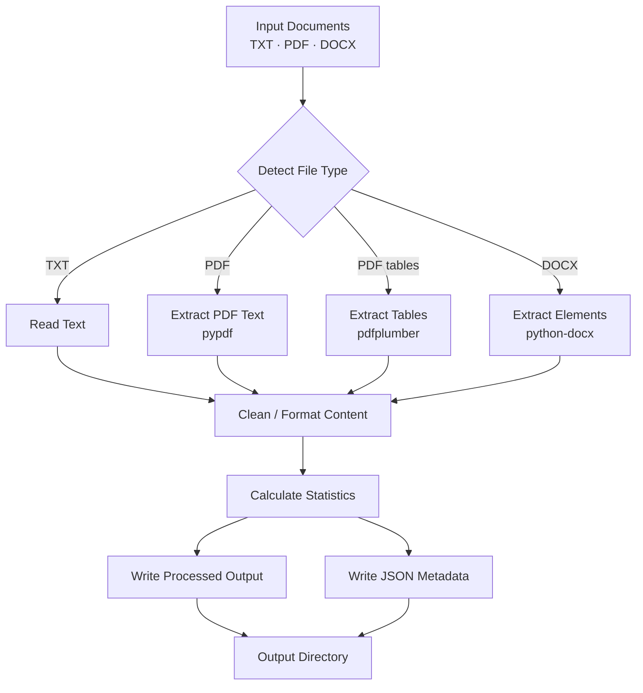

# DocuMind — Document Extraction CLI


DocuMind is a Python-based command-line tool that extracts text and basic table data from TXT, PDF, and DOCX documents. It produces readable output files and JSON metadata for further processing.

## Features

- **Multi-format support:** TXT, PDF, and DOCX files.
- **Text extraction:** Extracts embedded PDF text and reads text files and DOCX content.
- **Table extraction:** Detects basic tables in PDFs and preserves their rows and page numbers.
- **Structured DOCX processing:** Formats supported document elements, including headings, lists, and tables, as Markdown.
- **Text analysis:** Calculates character, word, and line counts.
- **JSON metadata:** Records source filenames, file types, statistics, and extracted structures.
- **Logging and error handling:** Reports processing activity and common file errors.
- **Automated tests:** Uses pytest to test document readers, formatting, and pipeline behaviour.

## Quick Example

```powershell
py main.py documents/sample_table.pdf
```

DocuMind writes the extracted output and JSON metadata to the `output/` directory.

## Project Structure

```text
DocuMind/
├── documents/                  # Sample input documents
├── processor/
│   ├── analyser.py             # Text statistics
│   ├── cleaner.py              # Text cleaning
│   ├── docx_reader.py          # DOCX extraction
│   ├── formatter.py            # Structured elements to Markdown
│   ├── pdf_reader.py           # PDF text extraction
│   └── pdf_table_reader.py     # PDF table extraction
├── tests/                      # Automated tests
├── main.py                     # CLI entry point
├── requirements.txt            # Python dependencies
└── .gitignore
```


## Architecture




## Requirements

- Python 3.10 or later
- pip

## Installation

Clone the repository and enter the project directory:

```bash
git clone https://github.com/RebyTK/DocuMind.git
cd DocuMind
```

Create and activate a virtual environment.

**Windows PowerShell:**

```powershell
py -m venv .venv
.venv\Scripts\Activate.ps1
```

Install dependencies:

```powershell
py -m pip install -r requirements.txt
```

## Usage

Place a supported document in the `documents/` folder, then run:

```powershell
py main.py documents/sample.txt
```

For PDF and DOCX files:

```powershell
py main.py documents/sample.pdf
py main.py documents/sample.docx
```

DocuMind writes the processed document and JSON metadata to the `output/` directory.

Typical outputs include:

- `sample_cleaned.txt` for TXT and PDF input
- `sample_cleaned.md` for DOCX input
- `sample_metadata.json` for extraction metadata
- `documind.log` for application logs

## Running Tests

Run the test suite from the project root:

```powershell
py -m pytest -v
```

The project currently includes tests for text cleaning, text analysis, PDF and DOCX extraction, formatting, and end-to-end processing.

## Limitations

- PDF table detection is best-effort and may not preserve complex layouts perfectly.
- Scanned PDFs that require OCR are not supported.
- Images embedded in documents are not interpreted as text.
- Extracted text and tables may not always retain the exact original document layout.
- This is a local CLI application; it does not currently provide a web interface or an LLM-based question-answering system.

## Future Improvements

Potential next steps include improving extraction quality, adding richer metadata, expanding test coverage, and building a simple interface.

## Tech Stack

Python · pypdf · pdfplumber · python-docx · pytest
