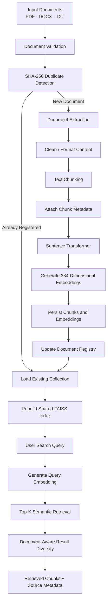

# DocuMind — Multi-Document Semantic Retrieval & RAG Foundation


**DocuMind** is a Python-based multi-document processing and semantic retrieval system built as a foundation for Retrieval-Augmented Generation (RAG). It extracts content from PDF, DOCX, and TXT files, generates transformer-based embeddings, and uses FAISS to retrieve relevant information across a persistent document collection.

The project focuses on building a modular document intelligence pipeline, covering document ingestion, text chunking, embedding generation, vector search, document management, and retrieval evaluation.

## Key Features

### 1. Multi-Format Document Processing

- **PDF extraction:** Extract embedded text page by page using `pypdf`.
- **PDF table extraction:** Extract tables using `pdfplumber` and incorporate them into their original page content.
- **DOCX processing:** Extract structured headings, paragraphs, lists, and tables using `python-docx`.
- **TXT processing:** Read and clean plain-text documents.
- **Content formatting:** Convert supported DOCX elements into Markdown.
- **Document analysis:** Calculate character, word, and line statistics.

### 2. Text Chunking & Metadata

- Character-based chunking with configurable chunk size and overlap.
- Default chunk size of 1,000 characters and overlap of 150 characters.
- Page-aware chunking for PDF documents.
- Unique document IDs and chunk IDs.
- Metadata preservation, including source filename, document ID, file type, chunk index, and page number where available.

### 3. Embedding Generation

- Dense vector embeddings using **Sentence Transformers**.
- Pretrained model: `all-MiniLM-L6-v2`.
- 384-dimensional embeddings.
- Batch embedding generation.
- Chunk text and metadata preserved alongside embeddings.

### 4. FAISS Semantic Retrieval

- FAISS vector indexing using `IndexFlatIP`.
- L2-normalized embeddings for cosine-similarity search.
- Query embedding generation using the same Sentence Transformer model.
- Top-K semantic retrieval.
- Document-aware result diversity to limit excessive chunks from a single document.
- Similarity scores returned with retrieved chunks.

### 5. Persistent Multi-Document Management

- Register and manage multiple documents through a JSON document registry.
- Persist document chunks and embeddings separately.
- Rebuild a shared FAISS index from all registered document embeddings.
- SHA-256 file hashing for duplicate document detection.
- Reuse previously ingested documents without processing duplicates again.

### 6. Retrieval Evaluation

- Manually curated retrieval evaluation queries.
- Precision@K.
- Recall@K.
- Reciprocal Rank.
- Mean Reciprocal Rank (MRR).
- Evaluation utilities and automated tests.

### 7. Engineering & Reliability

- Modular Python architecture.
- CLI-based document ingestion and semantic search using `argparse`.
- Logging and exception handling.
- Atomic JSON persistence for document registry and document data.
- Automated testing using `pytest`.
- GitHub Actions CI workflow.

## Architecture

DocuMind currently supports document ingestion, persistent storage, and semantic retrieval. LLM-based answer generation is planned as the next development milestone.



## Tech Stack

| Category | Technologies |
|---|---|
| Language | Python |
| Document Processing | pypdf, pdfplumber, python-docx |
| Text Processing | Python, pathlib |
| Embeddings | Sentence Transformers |
| Embedding Model | all-MiniLM-L6-v2 |
| Vector Search | FAISS (`faiss-cpu`) |
| Numerical Computing | NumPy |
| Data Serialization | JSON |
| Testing | pytest |
| CI/CD | GitHub Actions |

## Project Structure

```text
DocuMind/
│
├── .github/
│   └── workflows/
│       └── tests.yml
│
├── documents/                    # Input documents (local)
│
├── evaluation/
│   ├── __init__.py
│   ├── evaluate_retrieval.py     # Retrieval metrics and evaluation
│   ├── queries.json              # Curated evaluation queries
│   └── run_evaluation.py         # Evaluation runner
│
├── processor/
│   ├── analyser.py               # Document statistics
│   ├── cleaner.py                # Text cleaning
│   ├── chunker.py                # Chunking and metadata generation
│   ├── document_manager.py       # Registry and persistent storage
│   ├── docx_reader.py            # DOCX extraction
│   ├── embeddings.py             # Embedding generation
│   ├── formatter.py              # Structured elements to Markdown
│   ├── pdf_reader.py             # PDF text extraction
│   ├── pdf_table_reader.py       # PDF table extraction
│   └── vector_store.py           # FAISS indexing and semantic search
│
├── tests/
│   ├── test_analyser.py
│   ├── test_chunker.py
│   ├── test_cleaner.py
│   ├── test_document_manager.py
│   ├── test_docx_reader.py
│   ├── test_embeddings.py
│   ├── test_evaluation.py
│   ├── test_formatter.py
│   ├── test_pdf_reader.py
│   ├── test_pdf_table_reader.py
│   ├── test_pipeline.py
│   └── test_vector_store.py
│
├── inspect_chunks.py             # Chunk inspection utility
├── main.py                       # CLI entry point
├── requirements.txt
├── .gitignore
└── README.md

```

## Installation

### 1. Clone the repository

```bash
git clone https://github.com/RebyTK/DocuMind.git
cd DocuMind
```

### 2. Create a virtual environment

**Windows PowerShell:**

```powershell
py -m venv .venv
.venv\Scripts\Activate.ps1
```

### 3. Install dependencies

```powershell
py -m pip install -r requirements.txt
```

The first embedding-model initialization downloads `all-MiniLM-L6-v2` if it is not already available locally.

## Usage

Place your input documents inside the local `documents/` directory.

### 1. Ingest documents

Process a PDF:

```powershell
py main.py documents/sample.pdf
```

Process a DOCX:

```powershell
py main.py documents/sample.docx
```

Process a TXT file:

```powershell
py main.py documents/sample.txt
```

You can ingest multiple documents by running the command for each file. DocuMind registers each document and persists its chunks and embeddings.

Repeated ingestion of an already registered file is skipped using SHA-256 duplicate detection.

### 2. Search across registered documents

Once documents have been ingested, run semantic search:

```powershell
py main.py documents/sample.pdf --query "How does BERT differ from the original Transformer?" --top-k 5
```

The CLI currently requires a valid document path even when using `--query`. Pass a document already present in your collection to search without ingesting a duplicate.

**Search arguments:**

| Argument | Description | Default |
|---|---|---|
| `file` | Input document path | Required |
| `--query` | Semantic search query | None |
| `--top-k` | Number of chunks to retrieve | 3 |

Search results include:

- Source filename.
- Document ID.
- Chunk ID and chunk index.
- Page number when available.
- Similarity score.
- Retrieved chunk content.

## Data Persistence & Generated Outputs

Generated data is stored locally under `output/`.

| File / Directory | Description |
|---|---|
| `output/document_registry.json` | Registry of ingested documents |
| `output/documents/*_cleaned.txt` | Cleaned PDF/TXT content |
| `output/documents/*_cleaned.md` | Formatted DOCX content |
| `output/documents/*_metadata.json` | Document statistics and metadata |
| `output/documents/*_chunks.json` | Persisted text chunks |
| `output/documents/*_embeddings.json` | Chunks, metadata, and embeddings |
| `output/documind.log` | Application execution logs |

The shared FAISS index is rebuilt in memory from persisted embeddings when the CLI runs. The embedding data and document registry are persisted between runs.

Generated outputs and user-provided documents are excluded from Git.

## Running Tests

Run the complete test suite from the project root:

```powershell
python -m pytest -v
```

**Current local test status: 92 tests passing.**

The test suite covers:

- Text cleaning and validation.
- Document statistics.
- Chunk generation, overlap, and metadata.
- Document ID generation.
- PDF and DOCX extraction.
- PDF table extraction.
- Markdown formatting.
- Embedding generation.
- FAISS index creation and semantic search.
- Document registry and persistence.
- Duplicate document detection.
- Multi-document index rebuilding.
- Retrieval evaluation metrics.
- End-to-end processing pipelines.

## Current Limitations

- Scanned PDFs requiring OCR are not supported.
- Embedded images are not interpreted.
- PDF table extraction may not preserve complex layouts perfectly.
- Chunking uses character-based boundaries rather than semantic or structure-aware boundaries.
- Semantic retrieval quality can vary depending on query wording and document content.
- The FAISS index is rebuilt in memory from persisted embeddings rather than saved as a standalone index.
- LLM-based answer generation and conversational question answering are not implemented yet.
- Generated answers with source citations are not implemented yet.
- The application currently runs as a local CLI tool.

## Roadmap

- [x] Multi-format document extraction (PDF, DOCX, TXT).
- [x] Text chunking with overlap and metadata.
- [x] Transformer-based embedding generation.
- [x] FAISS vector indexing and semantic retrieval.
- [x] Persistent multi-document registry and storage.
- [x] Duplicate document detection.
- [x] Document-aware retrieval diversity.
- [x] Retrieval evaluation metrics.
- [ ] Local LLM integration using Ollama.
- [ ] RAG-based grounded question answering.
- [ ] Source attribution and citations in generated answers.
- [ ] Query decomposition and retrieval reranking.
- [ ] Improved retrieval evaluation and benchmarking.
- [ ] Streamlit user interface.
- [ ] FastAPI backend.
- [ ] Docker-based deployment.

## Project Goal

DocuMind is being developed as a practical AI Engineering portfolio project to explore document processing, vector embeddings, information retrieval, and RAG system architecture.

The long-term objective is to build a local knowledge intelligence platform that can retrieve relevant information from multiple documents and generate grounded, context-aware answers with source attribution.

---

**Built with Python, Sentence Transformers, FAISS, and a focus on practical AI Engineering.**

[GitHub Repository](https://github.com/RebyTK/DocuMind)
